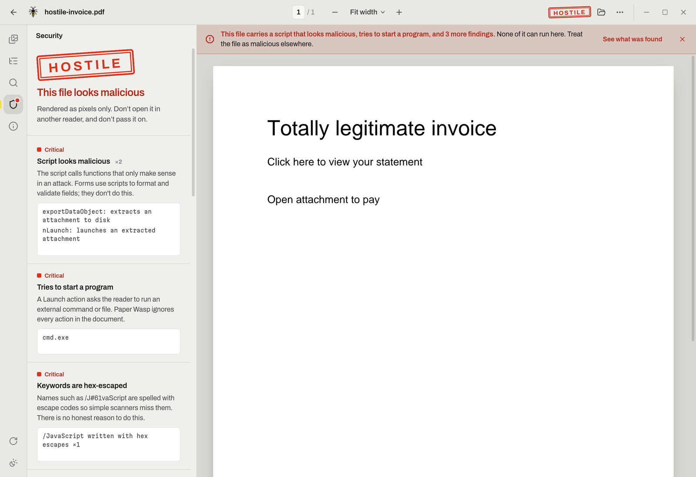
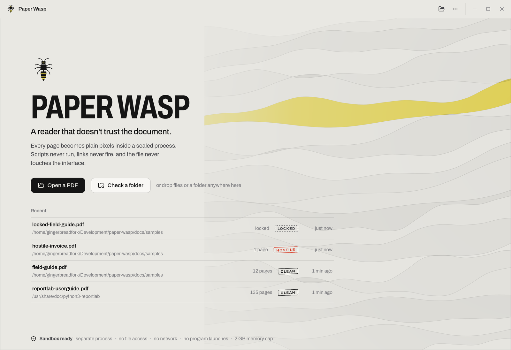
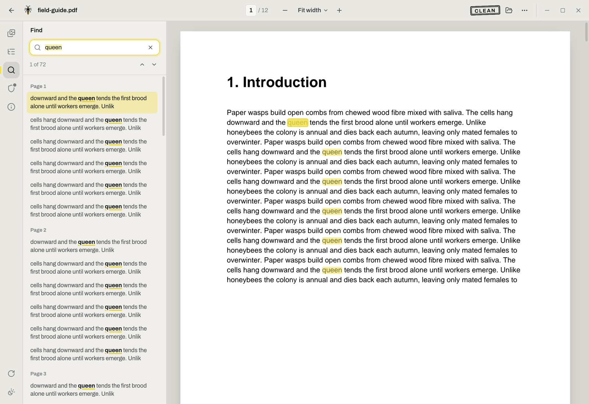
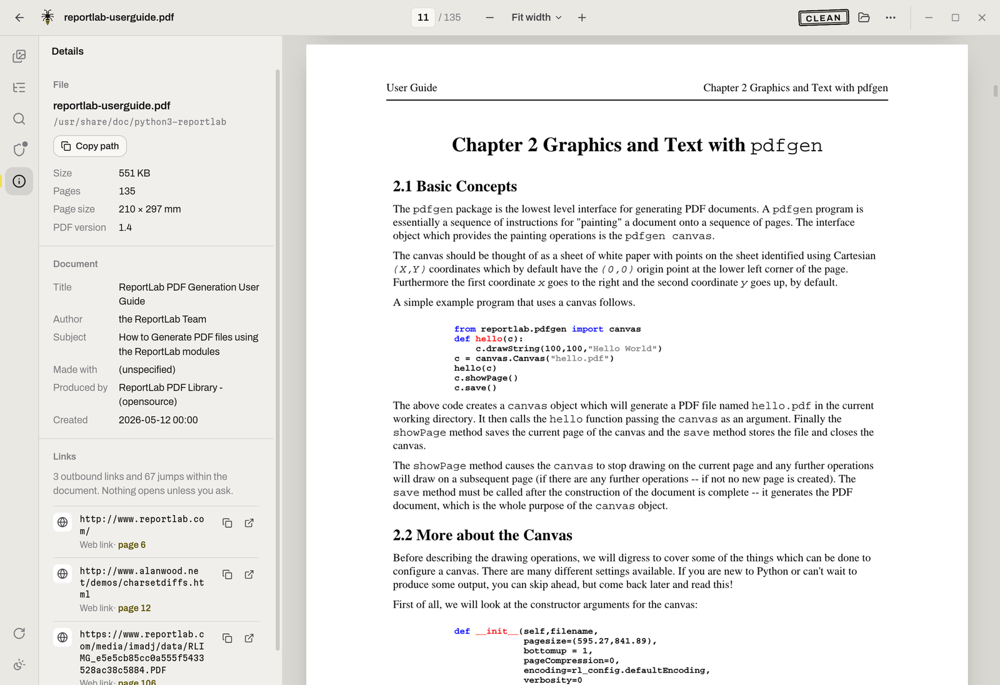
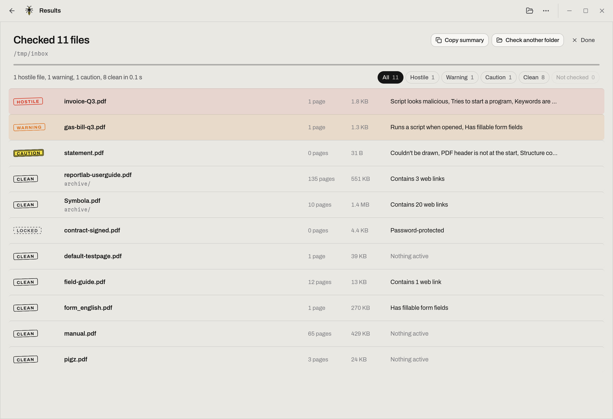

<p align="center">
  
</p>

<h1 align="center">Paper Wasp</h1>

<p align="center">
  A PDF reader for Linux that doesn't trust the document.<br>
  Open the attachment you were told not to open, read it in comfort,<br>
  and see exactly what it was trying to do.
</p>

<p align="center">
  <picture>
    <source media="(prefers-color-scheme: dark)" srcset="docs/screenshots/report-dark.png">
    
  </picture>
</p>

## Why

PDF readers run code. A PDF can carry JavaScript, actions that fire the moment the file opens,
forms that post to a server, launch actions that start programs, and attachments that are really
executables, and the readers people use every day do their best to honour all of it. That is why a
PDF is still the easiest thing to put in an email when you want into someone's machine.

Paper Wasp starts from the opposite assumption. The file is parsed and drawn in a separate process
that cannot open files, reach the network, or start programs. Each page becomes plain pixels, and
those pixels are all the window ever receives. Nothing in the document is interpreted by the part of
the app you look at. Then it tells you, in plain words, what the file contained, so you know whether
to delete it or whether it is safe to pass on.

It is still a reader you would choose on an ordinary day: quick to open, quiet to look at, with the
panels and shortcuts you expect.

## What it does

- **Opens anything.** The file dialog, drag and drop, the command line, or Open with from your file
  manager. A file that fails to parse still gets a security report; a file that parses but can't be
  drawn says so instead of showing a blank page.
- **Checks a whole folder.** Point it at a directory, select several files in the open dialog, or
  drop a handful of files on the window, and every PDF is inspected in turn, subfolders included.
  The results sort hostile first, filter by stamp, open with a click, and copy as a plain-text
  summary you can paste into a ticket.
- **Renders in a sealed process.** Pages are rasterised by [hayro](https://github.com/LaurenzV/hayro),
  a PDF renderer written in Rust with unsafe code forbidden, inside a worker locked down with
  Landlock, seccomp, namespaces and resource limits. There is no script engine anywhere in the app.
  If the worker crashes or runs out of memory, it is replaced and the page is retried; you see a
  retry button at worst.
- **Stamps a verdict.** Every file is inspected before you read it and stamped Clean, Caution,
  Warning or Hostile. Caution means the file has features worth knowing about, such as field
  scripts in a form; Warning means something runs or reaches out when the file opens elsewhere;
  Hostile is kept for things that only make sense in an attack. Each finding is explained in a
  sentence or two, with the evidence underneath: the first lines of any JavaScript, the program a
  launch action points at, the names of attached files.
- **Keeps links inert.** Nothing on the page is clickable. Outbound links, launch targets and form
  destinations are listed under Details, where you can copy one or open it in your browser on
  purpose.
- **Shows the fingerprint.** SHA-256, PDF version, object and stream counts, how many times the file
  was saved, and the metadata it carries, so you can check it against other tools without uploading
  it from here.
- **Reads well.** Continuous scrolling, fit width or fit page, free zoom with Ctrl and the wheel,
  rotation, thumbnails, table of contents, full-text search with highlights on the page, text
  selection and copy, and your place remembered for every file you reopen.
- **Looks after your eyes.** Light and dark themes that follow the system, and sepia or night page
  colours that recolour the document without touching the interface.
- **Opens password-protected files.** Enter the password once and the pages render; RC4, AES-128
  and AES-256 are all handled by the same memory-safe code inside the sandbox. The password lives
  in memory only while the file is open and is never written anywhere.
- **Keeps nothing but a list.** The scan never leaves your machine: the worker that reads the file
  has no network, and the window never holds the file's bytes. Locally, the app remembers only the
  path, name, page count, verdict and last page of the five files you opened most recently, no
  thumbnails or content, and each entry can be removed from the start page.

<p align="center">
  <picture>
    <source media="(prefers-color-scheme: dark)" srcset="docs/screenshots/landing-dark.png">
    
  </picture>
</p>

<p align="center">
  
  
</p>

<p align="center">
  <picture>
    <source media="(prefers-color-scheme: dark)" srcset="docs/screenshots/check-dark.png">
    
  </picture>
</p>

## The sandbox

The app binary doubles as the worker. The window process starts two workers with an empty
environment and talks to them over pipes only; a document is sent as bytes and comes back as PNG
pages, text positions and a report. Before a worker reads the first byte it:

1. Moves into fresh user, network, IPC and UTS namespaces, so it has no network at all.
2. Caps its memory at 2 GB, forbids writing files of any size, and disables core dumps.
3. Sets `no_new_privs`, so nothing it does can gain privileges.
4. Enforces a [Landlock](https://landlock.io) ruleset with no allowed paths. Every open, read and
   write of a file is denied by the kernel, including `/proc` and `/dev`.
5. Installs a seccomp filter that refuses `execve`, sockets, `ptrace`, mounts, kernel modules,
   `io_uring`, `bpf` and the `open` family.

Each page render has a time limit. A worker that hangs, crashes, panics, or hits the memory cap is
killed and replaced, the document is reloaded into the new one, and the request is retried once.
The start page and the Security panel show which layers are active. On a kernel without Landlock
the app still works and says so.

On Windows the worker is placed in a job object that caps its memory, stops it from creating any
other process, and keeps it away from the desktop and clipboard. That is less than Landlock and
seccomp give on Linux: the worker can still open files and reach the network, and the Security
panel says so. The rest of the design holds on both: pixels in, no script engine, memory-safe
parsing.

The window never sees PDF bytes. Pages arrive as images over an internal `wasp://` protocol, text
for search and selection arrives as plain strings with coordinates, and the report is structured
data. The webview's content security policy allows nothing else.

## What the scan looks for

The file is scanned twice: once at the byte level, which catches hex-escaped names and data hidden
outside the object graph, and once through the parsed object graph with
[lopdf](https://github.com/J-F-Liu/lopdf), which catches objects inside compressed object streams
that byte scanners miss. Findings are ranked and the highest decides the stamp.

| Finding | Stamp | What it means |
| --- | --- | --- |
| Launch action, hex-escaped keywords, polyglot header | Hostile | Starts a program, hides from scanners, or is also another file type |
| A script that extracts attachments, launches files, or uses a known exploit API | Hostile | Only makes sense in an attack |
| A script that runs on open, or reaches out: eval, unescape, launchURL, submitForm | Warning | Common in forms, also the first move of most malicious PDFs |
| Form submission to a server, attached program files, no PDF header | Warning | Sends data out, carries an executable, or isn't a PDF at all |
| Field scripts, auto-run actions without scripts, other documents referenced, attachments, embedded media, XFA forms | Caution | Features with a history of abuse, flattened to pixels here |
| Fillable fields, web links, encryption, trailing data, incremental saves | Clean, listed as notes | Worth knowing, not active |

A password-protected file is scanned before it is unlocked, but its strings and streams stay
encrypted until then, so the report says so and the scan runs again once you enter the password.

A utility bill with a script that formats the amount field lands on Caution; the same bill with a
script that fills in today's date when it opens lands on Warning; an invoice that extracts and
launches an attachment is Hostile. JavaScript is read in full and matched against a short list of
calls that have no honest use in a form.

Three sample files live in `docs/samples/`: a harmless twelve-page field guide, a locked copy of it
(`locked-field-guide.pdf`, password `paper`) to try the unlock prompt, and `hostile-invoice.pdf`, a
hand-built file with an on-open script, a launch action, a hex-escaped keyword and an attached
"executable". Open it to see the report; it cannot do anything here or anywhere else, since the
payload is a few bytes of text.

## Install

Packages for each release are on the [Releases page](https://github.com/Gingerbreadfork/paper-wasp/releases):
an `.rpm` for Fedora and friends, a `.deb` for Ubuntu and Debian, an `.AppImage` that runs anywhere,
and a `-setup.exe` installer for 64-bit Windows 10 and 11, with a `SHA256SUMS` file alongside each.

```sh
sudo dnf install ./Paper-Wasp-<version>-1.x86_64.rpm     # Fedora
sudo apt install ./Paper-Wasp_<version>_amd64.deb        # Ubuntu, Debian
chmod +x Paper-Wasp_<version>_amd64.AppImage && ./Paper-Wasp_<version>_amd64.AppImage
```

The Linux packages install the launcher entry, icons and the `application/pdf` association, so
Paper Wasp appears under Open with for any PDF.

On Windows, run `Paper-Wasp_<version>_x64-setup.exe`. It installs for your user only, with no
administrator prompt, and adds Paper Wasp to the Start menu. The installer carries no paid code
signing certificate, so SmartScreen may say the publisher is unknown: choose More info, then Run
anyway. The Windows build keeps the separate worker process, the memory cap and the rule that the
worker cannot start other programs, all enforced through a job object. File and network isolation
for the worker are Linux-only so far, and the Security panel says which layers are active.

### From source

You need Node 20 or newer, [pnpm](https://pnpm.io), a Rust toolchain, and on Linux the WebKitGTK
development packages that [Tauri 2 requires](https://v2.tauri.app/start/prerequisites/#linux).

```sh
git clone https://github.com/Gingerbreadfork/paper-wasp
cd paper-wasp
pnpm install
./install.sh --build      # Linux: builds and installs under ~/.local, no root needed
pnpm tauri build          # or just build the packages into src-tauri/target/release/bundle/
```

`install.sh` installs a launcher entry and icons alongside the binary. Pass `--default` as well to
make Paper Wasp the default PDF application. On Windows you need the Visual Studio Build Tools with
the "Desktop development with C++" workload, as the
[Tauri prerequisites](https://v2.tauri.app/start/prerequisites/#windows) describe; `pnpm tauri build`
then writes the installer to `src-tauri\target\release\bundle\nsis\`.

## Using it

Press `Ctrl O` or drop a file on the window. The page appears straight away and the stamp in the
title bar fills in a moment later when the scan finishes; click it, or press `S`, for the full
report. A Hostile file also shows a one-line banner above the page saying what was found.

To triage a pile of files, press `Ctrl Shift O` and pick a folder, select more than one file in the
open dialog, or drop files and folders on the window. Each file is loaded into its own sandboxed
worker, scanned and unloaded again; nothing is rendered until you open one. The list fills in as the
checks finish, then sorts hostile first. Filter by stamp, click a name to read it, and use Copy
summary for a plain-text list of every file and what was found in it.

The rail on the left opens the panels: pages, contents, find, security and details. `Esc` closes
whichever is open. Zoom with `Ctrl` and the mouse wheel or trackpad, or pick fit width, fit page
and fixed sizes from the menu in the title bar. The three-dot menu holds the theme, the page
colours, rotation and the shortcut list.

Text on the page can be selected and copied even though it is drawn as an image: the worker extracts
the text with its coordinates, and an invisible layer sits over the pixels. Search uses the same
text, so it finds words wherever they sit on the page and highlights every match.

### Keyboard

| Keys | Action |
| --- | --- |
| Ctrl O | Open a PDF, or several to check them together |
| Ctrl Shift O | Check every PDF in a folder |
| Ctrl W | Close the document |
| Ctrl F or / | Find |
| Enter, Shift Enter | Next or previous match |
| Ctrl + and Ctrl − | Zoom in and out |
| Ctrl 0, Ctrl 2, Ctrl 1 | Fit width, fit page, actual size |
| → and ← | Next and previous page |
| PgDn, PgUp, Space | Scroll a screen |
| Home, End | First and last page |
| G | Go to a page number |
| R | Rotate |
| N | Cycle page colours: paper, sepia, night |
| T, O, S, I | Pages, contents, security, details |
| Esc | Close the panel, clear highlights |
| ? | Keyboard shortcuts |

## Under the hood

```
src/                        Svelte 5 interface
  lib/state.svelte.ts       app state
  lib/session.ts            opening files, running the scan, recents
  lib/components/           title bar, start page, reader, panels
src-tauri/src/
  lib.rs                    Tauri setup, commands, the wasp:// page protocol
  host/                     worker pool, timeouts, respawn and retry
  worker/sandbox.rs         namespaces, rlimits, Landlock, seccomp
  worker/render.rs          page to PNG with hayro
  worker/scan.rs            byte-level and structural scan, outline, links, metadata
  worker/text.rs            text with positions for search and selection
  protocol.rs               wire types shared by host and worker
```

Built with [Tauri 2](https://v2.tauri.app) and [Svelte 5](https://svelte.dev). Rendering is
[hayro](https://github.com/LaurenzV/hayro), structure parsing is
[lopdf](https://github.com/J-F-Liu/lopdf), the sandbox uses the
[landlock](https://github.com/landlock-lsm/rust-landlock) and
[seccompiler](https://github.com/rust-vmm/seccompiler) crates. A release build is about 8 MB on
Linux and uses the system's own web view.

The look comes from the nest rather than the honey: cool grey paper for the interface, white only
for the document, black ink, a lemon highlighter for anything worth a second look, and sting red kept
for hostile findings. Verdicts are rubber stamps. Type is Archivo, with Martian Mono for hashes and
paths.

## What it won't do

- Run, follow or submit anything from the document. That is the point.
- Fill forms, annotate, print or edit. Other tools do those well, and each is a reason to trust the
  file more than Paper Wasp wants to.
- Open files over 512 MB.
- Isolate the worker from files and the network on Windows. Only Linux has that today.
- Run on Android yet. Tauri 2 can build for it and the renderer is pure Rust, but the worker
  process and sandbox would need an Android-specific design.

## Develop

```sh
pnpm install
pnpm tauri dev                          # native window with hot reload
pnpm tauri dev -- -- docs/samples/hostile-invoice.pdf   # open a file on launch
pnpm check                              # svelte-check
cargo build --manifest-path src-tauri/Cargo.toml
```

`pnpm dev` alone serves the interface in a browser, which is useful for styling but cannot open
files, since rendering needs the native worker.

In debug builds the app can be driven from a text file for screenshots and smoke tests: set
`PAPER_WASP_DRIVE=/path/to/file` and append lines such as `open /path/to/file.pdf`,
`batch /path/to/folder`, `panel security`, `theme dark`, `search queen`, `zoom 1.5` or `close`. The file is emptied after each
poll. Console output from the webview is forwarded to the terminal in debug builds as well.

The worker can be exercised on its own, which is the quickest way to test the sandbox and the
scanner: run `target/debug/paper-wasp --wasp-worker`, write a JSON line such as `{"op":"status"}`
to its stdin, and read the JSON reply from stdout. `{"op":"load","len":N}` followed by N bytes
loads a document; `render`, `scan`, `outline` and `text` then work on it.

`docs/samples/make-samples.py` rebuilds the sample PDFs; it needs `reportlab`, and `pypdf` for the
locked copy.

### Releasing

Pushing a tag like `v0.2.0` runs the release workflow, which checks the frontend and the Rust
crate, builds the Linux packages and the Windows installer, and attaches them with checksums to a
draft GitHub release for you to publish. The tag has to match the version in `package.json`,
`src-tauri/tauri.conf.json` and `src-tauri/Cargo.toml`; `./scripts/check-version.sh` tells you
whether the three agree. Running the workflow by hand from the Actions tab builds the same packages
and keeps them as workflow artifacts without making a release.

## License

MIT. See [LICENSE](LICENSE).
